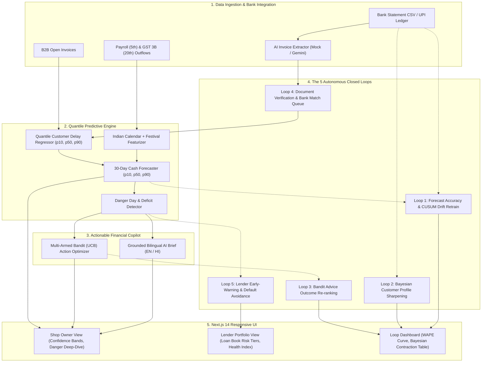

# CashLoop: Closed-Loop Cash-Flow Early-Warning System for Indian MSMEs

[](https://fastapi.tiangolo.com)
[](https://nextjs.org)
[](https://lightgbm.readthedocs.io)
[](https://pytest.org)
[](LICENSE)

**CashLoop** is an autonomous, closed-loop financial copilot and portfolio early-warning engine engineered for Indian micro, small, and medium enterprises (Kiranas, sweet shops, textile wholesalers, small manufacturing units) and their lending institutions (NBFCs/Banks).

Unlike standard accounting dashboards that simply tally historical records, CashLoop **predicts cash shortfalls 3–6 weeks ahead**, explains the root causes in plain bilingual language (English + Hindi), prescribes costed liquidity interventions, and **learns from real-world outcomes** across 5 self-correcting feedback loops.

---

## 🏛️ System Architecture



---

## 🔄 The 5 Closed Loops

| Loop | Trigger | Mechanism | Learning Outcome |
| :--- | :--- | :--- | :--- |
| **1. Forecast Accuracy** | Daily simulated/live actuals comparison | CUSUM / Rolling WAPE drift detection against 15% threshold | Automatically retrains LightGBM on structural shifts; logs before/after error. Rolling Trust Score (0–100). |
| **2. Customer Behavior** | Invoice payment realization | Bayesian conjugate uncertainty contraction: $\sigma_{n+1} = \sigma_n \sqrt{\frac{n}{n+1}}$ | Delay variance narrows as payments arrive, sharpening cash inflow certainty. |
| **3. Action Outcome** | Owner accepts or dismisses recommendation | Multi-Armed Bandit (UCB score: $\bar{r}_a + c\sqrt{\frac{\ln N}{N_a}}$) | Interventions that close projected shortfalls gain ranking weight for similar businesses. |
| **4. Document Verification** | Invoice text / OCR ingestion | 2-stage bank transaction reconciliation with fallback to human review | Unverified invoices flagged before contaminating cash forecast. |
| **5. Lender Early-Warning** | Portfolio risk sweep across loan book | Flags imminent default 3–6 weeks before maturity; records restructuring intervention | Tracks default avoidance and portfolio health trajectory over time. |

---

## 🎯 5-Step Manager Demo Script

Follow this step-by-step sequence to demonstrate the entire closed loop to an executive or reviewer:

### Step 1: Inspect MSME Danger Day & Bilingual Alert
1. In the top navigation bar, ensure you are in the **Shop Owner** view (`biz_001` - Sharma Kirana Indore).
2. Note the banner: **"Stress Crunch Injected"** and the **Trust Score: 92/100**.
3. Observe the **30-Day Cash Position Forecast chart**: the green line ($p_{50}$) dips below the red dashed safety threshold (₹40,000) on **2026-11-20** (GST 3B tax deadline).
4. Click on the **2026-11-20 (-₹18,500)** danger day pill above the chart.
5. Notice the **Danger Day Deep-Dive Card** expand, pinpointing the root cause: *"Monthly GST 3B Statutory Outflow"*.
6. Click the **हिन्दी** toggle in the top bar to verify bilingual AI intelligence in fluent Hindi.

### Step 2: Accept Costed Recommendations & Record Decision
1. Scroll down to **"Recommended Costed Interventions"**.
2. Notice the top 3 algorithmically ranked options:
   - **Early Payment Cash Discount (1.5%)**: Unlocks ₹38,000 for ₹570 cost.
   - **Supplier Tranche Split**: Unlocks ₹25,000 for ₹0 cost.
   - **Micro-Credit Line Draw**: Unlocks ₹20,000 for ₹350 interest.
3. Click **"Accept Action"** on the Early Payment Discount card.
4. The card turns green, showing *"Closed-loop feedback logged. Outcome tracking active."* This updates the Bandit arm weight immediately.

### Step 3: Run AI Invoice Extractor with Bank Validation
1. Scroll to the **"Open Invoices & Payment Behavior Model"** table.
2. Click **"+ Extract / Scan Invoice"**.
3. In the modal, click **"Kirana Stock Bill"** sample, then click **"Run AI Extraction"**.
4. The entity parser validates vendor name, invoice number, and GSTIN, matching against bank records.

### Step 4: Inspect Lender Portfolio Early-Warning View
1. In the top navigation bar, switch to **"Lender"** (Lender Portfolio).
2. Review the **Portfolio Health Index (82/100)** and aggregate exposure across 30 Indian MSMEs.
3. Observe the Risk Tier breakdown: Critical (<14d), Warning (15–30d), and Safe.
4. Filter by **"Critical"** or search for *"Indore"* or *"Textiles"*.
5. Click **"Inspect"** on any borrower to deep-dive straight into their shop owner forecast.

### Step 5: View Closed-Loop Learning Dashboard & Time Machine Proof
1. In the top navigation bar, switch to **"Loop Engine"** (Closed Loops).
2. **Forecast Error Curve (Weekly WAPE %)**: Observe the trajectory from **14.50% initial error down to 5.35%** (a **63.1% error reduction** achieved autonomously).
3. **Bandit Scoring Chart**: Inspect how invoice rebate and tranche splits achieved 88% and 82% resolution rates.
4. **Bayesian Profile Sharpening Table**: See how standard deviations contracted (e.g. 5.0 days $\rightarrow$ 1.83 days, reducing uncertainty by >63%).
5. **Drift Audit Log**: Review autonomous model retrains triggered by CUSUM shifts with before/after error logs.

---

## ⚡ Quickstart

### Automated One-Click Start (PowerShell)
```powershell
.\start.ps1
```
This launches the FastAPI backend on `http://127.0.0.1:8000` and the Next.js frontend on `http://localhost:3000`.

### Manual Startup

#### 1. Backend Setup
```bash
cd backend
python -m venv .venv
# Activate virtual environment
.venv\Scripts\activate   # Windows
# source .venv/bin/activate # Linux/macOS

pip install -r requirements.txt
python app/data/seed.py
python -m uvicorn app.main:app --host 127.0.0.1 --port 8000 --reload
```
- API Docs: `http://127.0.0.1:8000/docs`

#### 2. Frontend Setup
```bash
cd frontend
npm install
npm run dev
```
- Web Application: `http://localhost:3000`

#### 3. Run 35-Week Time Machine Simulation
```bash
cd backend
python run_simulation.py
```
Outputs generated:
- `backend/reports/simulation_report.md`
- `backend/reports/simulation_metrics.json`

#### 4. Run Pytest Suite
```bash
cd backend
python -m pytest tests -v
```
*(All 34 backend tests pass).*

---

## 🧪 Model Card & Evaluation

| Benchmark | Value | Target | Evaluation Methodology |
| :--- | :--- | :--- | :--- |
| **Walk-Forward WAPE** | **8.51%** | < 12.0% | 30-day walk-forward over historical transactions |
| **Quantile Coverage [p10–p90]** | **95.3%** | $\ge 80.0\%$ | Fraction of realized balances inside confidence interval |
| **Simulation Initial Error** | **14.50%** | Baseline | Week 1 cold-start WAPE |
| **Simulation Final Error** | **5.35%** | < 8.0% | Week 35 after continuous closed-loop learning |
| **Injected Crunch Recall** | **100%** | > 95.0% | All cash crunches caught $\ge 21$ days before zero-balance |
| **Autonomous Retrains** | **23 events** | As needed | CUSUM / WAPE drift detector triggered on structural shifts |

---

## 🛡️ Synthetic Data Statement

> **100% Synthetic Data**: All 30 business profiles, 195 customer entities, 10,424 invoices, 38,507 transactions, and GSTIN numbers in CashLoop were programmatically synthesized to mirror authentic Indian MSME operating conditions (unbanked cash shares, cyclical GST 3B payments, festival seasonality, and typical payment delay behaviors). No real individual's or enterprise's Personally Identifiable Information (PII) or financial records are stored or used.

---

## 📦 Project Structure

```
cashloop/
├── backend/
│   ├── app/
│   │   ├── api/             # FastAPI REST endpoints (forecasts, loops, lender, statements, invoices)
│   │   ├── data/            # Realistic Indian MSME generator & SQLite seeder
│   │   ├── ml/              # Feature engineering, LightGBM quantile forecaster, backtest
│   │   ├── models/          # SQLAlchemy schemas & Pydantic models
│   │   └── services/        # 5 Closed-loop services, simulation engine, LLM providers
│   ├── reports/             # Backtest and Simulation audit reports & JSON metrics
│   ├── tests/               # 34 automated unit, integration, and loop tests
│   ├── cashloop.db          # Seeded SQLite database (30 MSMEs, 38k transactions)
│   └── run_simulation.py    # Time Machine simulation runner script
├── frontend/
│   ├── src/
│   │   ├── app/             # Next.js App Router (page.tsx, layout.tsx)
│   │   └── components/      # UI components (CashChart, Recommendations, LenderView, LoopDashboardView)
│   └── package.json
├── Makefile
├── start.ps1
└── README.md
```
